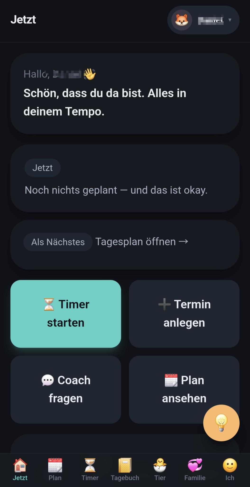
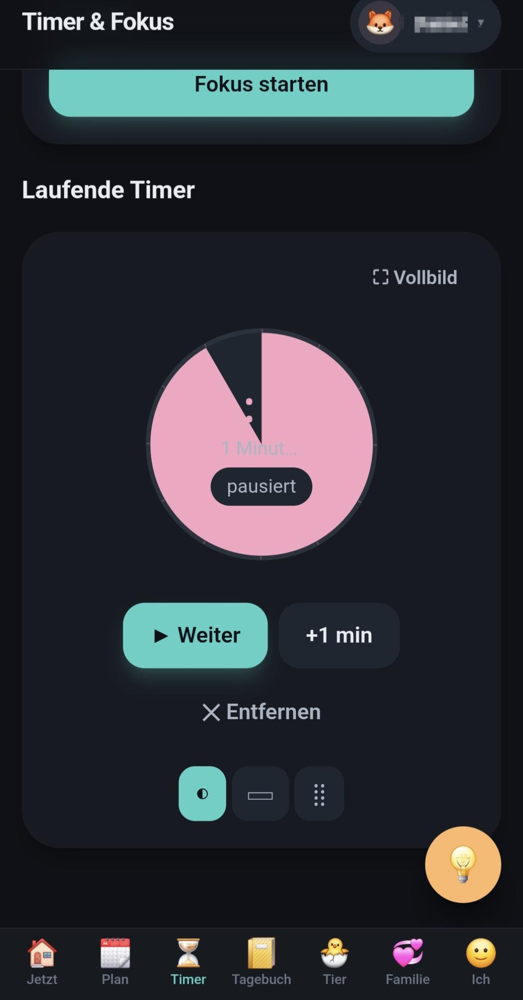
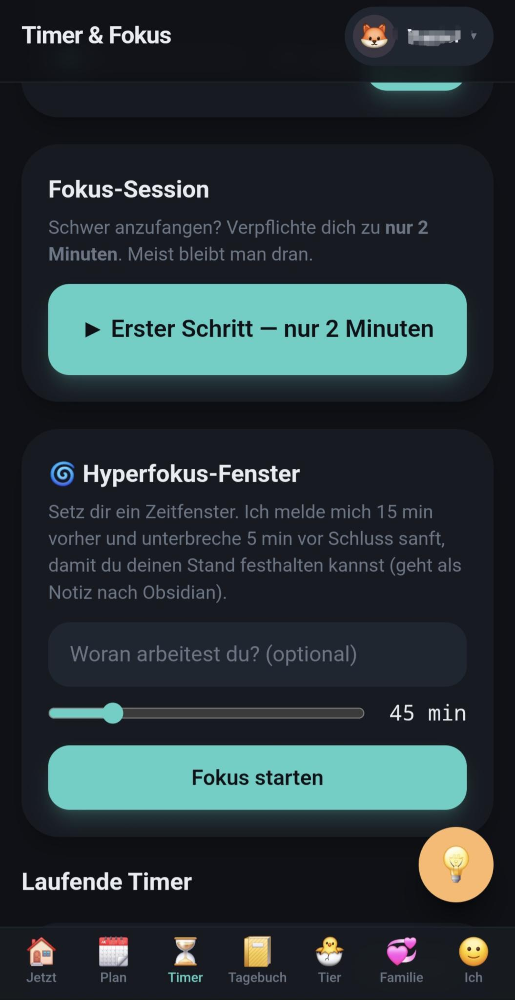
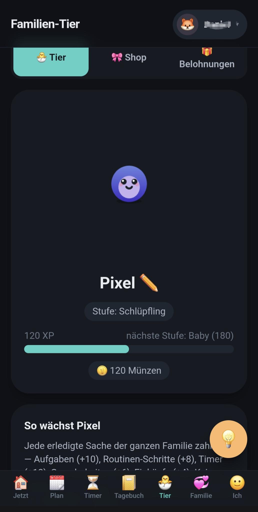
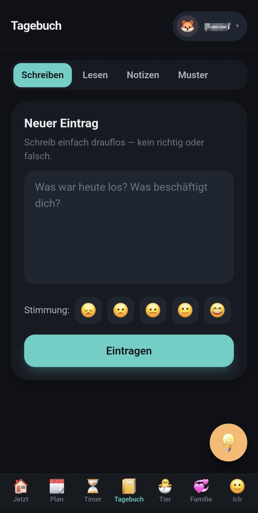
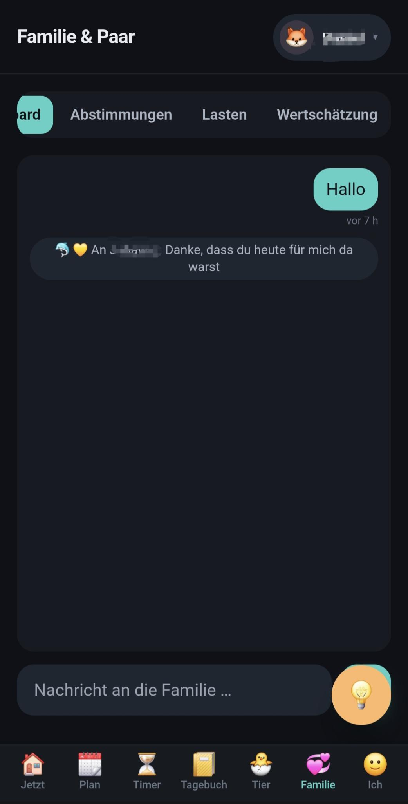
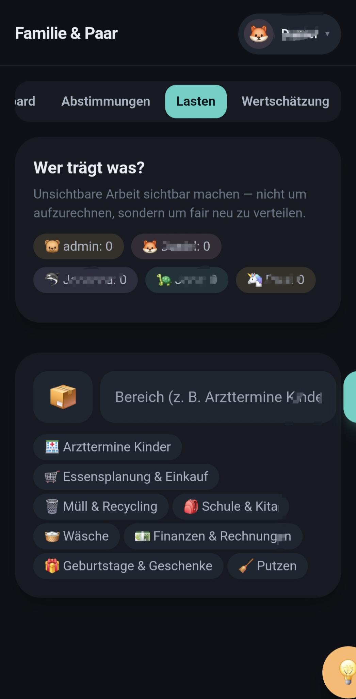

# JARVIS ADHS-Helper 🧩

**Ruhige, neurodiversitäts-gerechte Familien-App** — eine offline-first **PWA**, die als Client für
das [JARVIS](https://github.com/bmetallica/JARVIS)-Ökosystem dient. Sie unterstützt Familien mit
ADHS (Eltern wie Kinder) im Alltag: visuelle Timer, Routinen, Termine mit Vorlaufzeit, ein
kooperatives Familien-Tier, ein gemeinsames Tagebuch, Abstimmungen und mehr — alles bewusst
ADHS-freundlich gestaltet.

> Repo: <https://github.com/bmetallica/jarvis_adhs-helper> · Gateway-Projekt:
> <https://github.com/bmetallica/JARVIS>

Die App läuft **vollständig offline/lokal**. Die KI-Funktionen (Coach, Sprache, Tagebuch-Muster,
Termin-Erkennung, Vision) sind **optionale Veredelung** über das JARVIS-Gateway und nie Voraussetzung.

---

## 📱 Screenshots

<table>
  <tr>
    <td align="center"><br><sub>Jetzt (Dashboard)</sub></td>
    <td align="center"><br><sub>Visueller Timer</sub></td>
    <td align="center"><br><sub>Fokus &amp; Hyperfokus</sub></td>
    <td align="center"><br><sub>Familien-Tier</sub></td>
  </tr>
  <tr>
    <td align="center"><br><sub>Tagebuch</sub></td>
    <td align="center"><br><sub>Familienchat</sub></td>
    <td align="center"><br><sub>Mental-Load / Fair-Share</sub></td>
    <td></td>
  </tr>
</table>

---

## ✨ Leitidee

ADHS ist kein „Produktivitäts-Defizit", sondern eine andere Neurobiologie. Die App ist um diese
Realität herum gebaut. Acht Designgesetze (Details in [`KONZEPT.md`](KONZEPT.md)):

1. **Vergebung statt Versagen** — nichts „stirbt", nichts wird rot, keine zerbrechenden Streaks (RSD-Schutz).
2. **Zeit sichtbar machen** — Schrumpfscheiben, Countdown „in X Schlafen", Losgeh-Zeiten.
3. **Atomisieren** — große Dinge zerfallen in den nächsten Mini-Schritt.
4. **Sofort belohnen** — unmittelbares, spürbares Feedback.
5. **Externalisieren** — die App erinnert, der Kopf muss nichts behalten.
6. **Neutral erinnern** — die App nörgelt, nicht der Partner.
7. **Autonomie wahren** — Wahl statt Befehl.
8. **Offline zuerst** — Kernfunktionen brauchen weder Netz noch KI.

---

## 🧰 Funktionsumfang

**Fokus & Zeit**
- Visuelle Timer (Schrumpfscheibe / Balken / Punkte), Vollbild-/Kioskmodus, sanfte Vorwarnungen
- „Erster Schritt"-Fokus (Wall of Awful) und **Hyperfokus-Helfer** mit sanfter Unterbrechung +
  Stand-Notiz → Obsidian (offline gepuffert)

**Planung**
- Routinen mit Ein-Schritt-Fokus + Vorlagen
- Now-Next-Board, Aufgaben, globaler **Brain-Dump** (Text/Sprache)
- **Termine mit Vorlauf-/Losgeh-Zeit**, Vorbereitungs-Checklisten, mehrstufige Erinnerungen
- Fristen (Wall-of-Awful-Zerlegung), Einkaufsliste, Wochen-Essensplan, Gewohnheiten („Garten" ohne Streak-Scham)

**Familie**
- **Kooperatives Familien-Tier** (Canvas, 7 Wachstumsstufen, stirbt nie) + Accessoire-Shop + Belohnungs-Laden
- **Nachrichtenboard / Familienchat**
- **Abstimmungen** (allgemein) inkl. **Termin-Vorschlag mit Konfliktcheck und Ja/Nein-Abstimmung**
  (bei Zustimmung wird der Termin automatisch angelegt)
- Mental-Load/Fair-Share, Wertschätzungs-Feed, Pause-/Atem-Protokoll, Wochen-Sync, RSD-Kommunikations-Reframe

**Gesundheit & Reflexion**
- **Tagebuch** mit Tagesansicht (vollständiger Tagesrückblick aller Aktivitäten)
- **Medikations-Tracker** (Einnahme, nächste Dosis, Rebound-Fenster, Erinnerungen)
- Stimmungs-/Energie-/Fokus-Check-in, Ruhe-Ecke (Atem-Guide + Fidget)

**KI über JARVIS (optional, mit Offline-Fallback)**
- Empathischer Coach-Chat (SSE), Micro-Task-/Termin-Parser, STT/TTS, RAG-Tagebuch + Mustersuche,
  Vision (Beleg-OCR, Medikationsscan, Aufräum-Check)

**Komfort & Bedienung**
- „Braucht deine Aufmerksamkeit"-Übersicht + Navigations-Badges
- Wand-Tablet-**Hauptquartier** (Wochenkalender mit Terminen & Essen, Familienchat, kleines Tier)
- Barrierefreiheit (große/lesbare Schrift, Reizarm-Modus, Bewegungsreduktion), Dark-Mode-first

---

## 🏗️ Architektur

- **Offline-first PWA** (Svelte 5). Alle Kernfunktionen laufen lokal in **IndexedDB**.
- **Accounts = JARVIS-Nutzer**: Die Familien-Roster werden zentral aus JARVIS geladen und erscheinen
  auf jedem Gerät; man wählt beim Start seinen Account.
- **Per-Account-Datensynchronisation**: Persönliche Daten folgen dem Login über alle Geräte
  (scope=user), Familien-Listen sind geteilt (scope=shared).
- **Zentraler Proxy**: Der mitgelieferte Server (`server/serve.js`) relayt `/api/*` (inkl. WebSocket)
  an JARVIS. Dadurch bleibt **JARVIS LAN-intern**, der Plugin-Key liegt nur serverseitig, und es gibt
  kein CORS-/Zertifikatsproblem im Browser.

```
 Browser/Handy ──HTTP(S)──► [adhs-helper :8096] ──Proxy /api/*──► [JARVIS :8088]
                             (Frontend + Proxy + Master-Login)        (nur LAN!)
```

Vollständige Plugin-/Gateway-Spezifikation: [`material/pluginsystem.md`](material/pluginsystem.md).

---

## 🧱 Tech-Stack

Svelte 5 (Runes) · Vite 6 · TypeScript · Tailwind CSS v3 · IndexedDB (`idb`) · HTML5 Canvas ·
Service-Worker-PWA · abhängigkeitsfreier Node-Produktionsserver (Proxy + Auth).

---

## 🚀 Schnellstart (Entwicklung)

Voraussetzung: **Node.js ≥ 20** und npm.

```bash
git clone https://github.com/bmetallica/jarvis_adhs-helper.git
cd jarvis_adhs-helper
npm install
npm run dev          # Dev-Server (http://localhost:5173)
```

Weitere Skripte:

```bash
npm run build        # Produktions-Build nach dist/ (tsc-Check + vite build)
npm run check        # svelte-check (Typen/Templates)
npm run preview      # gebauten Stand lokal servieren (Vite)
npm run serve        # gebauten Stand mit dem Produktionsserver ausliefern (server/serve.js)
```

> Hinweis: **Mikrofon/STT** funktioniert nur im *sicheren Kontext* (HTTPS oder `localhost`). Über
> `http://<IP>` sperrt der Browser den Mikrofonzugriff.

---

## 🖥️ Betrieb / Deployment

Als **Debian-Dienst (systemd)** installierbar — Details in **[`DEPLOY.md`](DEPLOY.md)**:

```bash
sudo ./deploy/install.sh
```

Konfiguration über `/etc/adhs-helper.env` (Vorlage: `deploy/adhs-helper.env.example`):

```ini
# Zentraler Proxy zu JARVIS (empfohlen) — JARVIS bleibt LAN-only
JARVIS_UPSTREAM=https://192.168.1.224:8088
JARVIS_KEY=jvp_adhs_DEIN_KEY
JARVIS_INSECURE=1

# Internet-Exposition: Master-Passwort schützt /api/* serverseitig
APP_PASSWORD=euer-familien-passwort
APP_SESSION_SECRET=<openssl rand -hex 32>
HOST=127.0.0.1
PORT=8096
```

### Aus dem Internet erreichbar machen (sicher)

Einen Reverse-Proxy (z. B. Caddy) **nur** auf den adhs-helper zeigen lassen — niemals auf JARVIS:

```caddy
adhs.deine-domain.de {
    reverse_proxy 127.0.0.1:8096
}
```

- **JARVIS bleibt LAN-intern** und ist nie aus dem Internet erreichbar; der adhs-helper relayt.
- **Master-Authentifizierung** (`APP_PASSWORD`) schützt serverseitig `/api/*` und den WebSocket
  (signiertes Session-Cookie, Brute-Force-Limit). In der App kann man danach frei zwischen den
  Familien-Profilen wechseln.
- Mit gültigem Zertifikat funktionieren Mikrofon/STT, PWA-Installation und Web-Push.

Vollständige Anleitung inkl. TLS-Phasen und Fehlersuche: [`DEPLOY.md`](DEPLOY.md).

---

## 🔌 JARVIS-Integration

Der ADHS-Helper ist ein **externes Plugin (Typ A)** für JARVIS und nutzt dessen versioniertes
Gateway `/api/v1/*` (LLM, STT/TTS, RAG, Storage, Events, Scheduler, Tools, Notify). Das Manifest
liegt in [`plugin.json`](plugin.json); registriert wird es im JARVIS-Admin-UI (Key mit Scope
`api:act_as_user` für die Account-Funktion). Spezifikation: [`material/pluginsystem.md`](material/pluginsystem.md).

---

## 📁 Projektstruktur

```
src/
  App.svelte            # Shell: Header, Router, Bottom-Nav, globale Overlays
  main.ts               # Bootstrap (Config/Auth laden, Stores, Sync starten)
  lib/
    stores/             # Svelte-Stores (tasks, appointments, pet, polls, diary, …)
    components/          # UI-Bausteine (Timer, PetCanvas, PollCard, …)
    screens/            # Home, Plan, Timer, Diary, Pet, Family, Me, Kiosk
    jarvis/             # client.ts (Gateway-Tor), queue.ts, events.ts (WS)
    datasync.ts         # Per-Account-Snapshot-Sync
    ai.ts               # KI-Aufgaben mit Offline-Fallback
    db.ts               # IndexedDB-Schema
server/
  serve.js              # Produktionsserver: statisch + JARVIS-Proxy + Master-Auth
deploy/                 # systemd-Unit, Install-/Cert-Skripte, env-Vorlage
public/                 # PWA-Manifest, Service-Worker, Icons
material/               # Ursprungs-Idee + JARVIS-Plugin-Spezifikation
```

---

## 📚 Dokumentation

- [`KONZEPT.md`](KONZEPT.md) — vollständiges Anwendungskonzept (ADHS-Grundlagen, Module, UX)
- [`ROADMAP.md`](ROADMAP.md) — Umsetzungsstand & Änderungslog
- [`ROADMAP_V2.md`](ROADMAP_V2.md) — geplante Erweiterungsmodule (Medikations-Bürokratie, Übergabe-Modus, SOS-Overwhelm, Doom-Box, Safe-Food-Joker, Such-Gedächtnis)
- [`AUDIT.md`](AUDIT.md) — Funktions-Audit (ADHS-Eignung, Lücken, Folgepunkte)
- [`DEPLOY.md`](DEPLOY.md) — Betrieb, Reverse-Proxy, Internet-Exposition, TLS
- [`material/pluginsystem.md`](material/pluginsystem.md) — JARVIS-Gateway-/Plugin-Spezifikation

---

## 🔐 Datenschutz & Sicherheit

Hochsensible Daten (Medikation, Verhaltensmuster, Beziehungskonflikte) bleiben **lokal bzw. im LAN**.
Pro-Nutzer-Isolation über JARVIS-Namespaces; serverseitige Master-Auth schützt die Internet-
Exposition; TLS-Schlüssel sind via `.gitignore` ausgeschlossen.

---

## 📄 Lizenz

[MIT](LICENSE) — frei nutzbar, anpassbar und weitergebbar. Beiträge/Issues willkommen.
